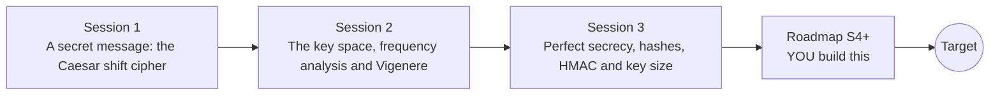

# opencrypto

[](https://github.com/KrunalPanchal1995/opencrypto/actions/workflows/ci.yml)   [](https://colab.research.google.com/github/KrunalPanchal1995/opencrypto/blob/main/sessions/session-01/lesson.ipynb) [](https://krunalpanchal1995.github.io/opencrypto/)

**Break a toy cipher, then fix it, and see why keys matter, in three sessions.**

opencrypto teaches the basics of encryption by letting you break toy ciphers yourself: Caesar, substitution and Vigenere, then the one-time pad, hashes and HMAC, using only Python and a browser.

- **Break it to understand it.** You attack toy ciphers on your own toy data, so you see exactly why they fail.
- **See it move.** Every session ships a slider app that runs in the browser, with labelled graphs.
- **Know you got it right.** Each session ends with a checkpoint that prints PASS or FAIL against hand calculations and standard test vectors.
- **Build the missing half.** The repo stops at Session 3 on purpose; the roadmap shows the path to the Target.

[Target](#the-target) · [Who is this for](#who-is-this-for) · [Quick start](#quick-start) · [Sessions](#sessions) · [Roadmap](#roadmap) · [Contribute](#contribute) · [Explainer PDF](docs/explainer.pdf)

> **This repo is incomplete on purpose.** Sessions 1 to 3 are here and fully working. The finished Target below is a preview of what the community can build next. We show you the path, not the code. Sessions 4 and up are yours.

## The Target

An animated attack on a substitution cipher whose key space is 26! (about 4 x 10^26 keys, 88 bits). The ciphertext letter counts are matched to English, then improved step by step; the histogram slides into line with English and the text turns readable. A chart beside it shows key size against the time to try every key, with the attack's own effort marked: a few thousand key tests instead of 4 x 10^26. Your goal over the coming sessions: build that attack yourself, and then learn how modern designs avoid exactly this kind of weakness.


*Target: frequency analysis recovers a substitution key; the chart shows 26! keys against the attack's effort*


*Target, final frame: the histogram lines up with English and the text is readable*

Try it live:

- [Math Visual Studio (Studio root): explore the mathematics behind the lessons](https://krunalpanchal1995.github.io/studio/)

How the Target was made is shown only as a path in [promo/roadmap.md](promo/roadmap.md).

## Who is this for
**secondary school to diploma / undergraduate (levels 3-5).** Topic area: Computer Science, Programming and Software.

Prerequisites:

- Remainders (the clock arithmetic of 'mod') and basic percentages; Section B explains the rest.
- Python 3.10 or newer; if `python --version` works, you are ready. PRIMER.md explains the rest.
- No prior cybersecurity, GitHub or advanced maths is needed.

New to Python? Read [PRIMER.md](PRIMER.md) first (10 minutes).

## Quick start

No installation knowledge needed. You need [Git](https://git-scm.com/downloads) and [Python 3.10+](https://www.python.org/downloads/) (Windows: tick "Add Python to PATH"). On Mac and Linux type `python3` wherever this page says `python`.

```bash
git clone https://github.com/KrunalPanchal1995/opencrypto.git
cd opencrypto
python start.py 1
```

`start.py` creates a private environment, installs what is needed and runs Session 1 with its checkpoint. Next: `python start.py 2`, `python start.py 3`, or `python start.py test` to check everything. Only a checkpoint: `python start.py check 1`.

Four lines turn the idea of Session 1 into a result (they work as they are): Save it as `try.py` and run it with `python start.py run try.py` (this uses the private environment, where NumPy is installed):

```python
import string
A = string.ascii_uppercase
shift = lambda t, k: "".join(A[(A.index(c) + k) % 26] if c in A else c for c in t)
print(shift("HELLO", 3), shift(shift("HELLO", 3), -3))    # -> KHOOR HELLO
```

Every session also opens in your browser with sliders (no install): [live apps](https://krunalpanchal1995.github.io/opencrypto/). Or use the Colab badge above for the notebook.

## Sessions

| # | Session | Model level | Time | Live app |
|---|---|---|---|---|
| 1 | [A secret message: the Caesar shift cipher](sessions/session-01/README.md) | Level 1: conceptual interactive model | 60 min | [open](https://krunalpanchal1995.github.io/opencrypto/session-01/) |
| 2 | [The key space, frequency analysis and Vigenere](sessions/session-02/README.md) | Level 2: mathematical engineering model | 75 min | [open](https://krunalpanchal1995.github.io/opencrypto/session-02/) |
| 3 | [Perfect secrecy, hashes, HMAC and key size](sessions/session-03/README.md) | Level 3: simulation and validation | 90 min | [open](https://krunalpanchal1995.github.io/opencrypto/session-03/) |

Each session follows the same six steps: A real-world problem, B concept and theory, C visual explanation, D interactive simulation, E worked example and experiment, F assessment and design challenge. Each ends with `checkpoint.py`, which prints `PASS` or `FAIL` against reference numbers. Session 3 also contains the real-world mini-project: **Decrypt a Vigenere ciphertext you did not write the key for**.

## Architecture



| Folder or file | What is inside |
|---|---|
| `sessions/` | three sessions: README (A-F), `lesson.py`, notebook, live app, exercises, activity sheet, checkpoint |
| `promo/` | the Target: media, live links, and the roadmap (path only) |
| `docs/` | `explainer.tex` and the built `explainer.pdf` |
| `tests/` | runs every lesson and checkpoint headless |
| `start.py` | one command to set up and run anything |
| `QUALITY.md`, `RUBRIC.md` | the quality checklist and the scoring rubric |
| `.github/` | CI, PDF build, Pages deploy, issue and PR templates |

## Roadmap

| Milestone | What you will build | Difficulty |
|---|---|---|
| Session 4: Break a substitution cipher completely | A solver that starts from frequency ranks and improves the key with a score for letter pairs. | intermediate |
| Session 5: Vigenere with any key length | A Vigenere breaker that searches key lengths up to 20. | intermediate |
| Session 6: Why modes of operation matter | A toy 8-byte block cipher used in two modes, with a pattern counter. | advanced |
| Session 7: How strong is a password? | A calculator for bits of entropy and the time to try every password at an assumed rate and hash cost. | intermediate |
| Session 8: Public keys with a toy RSA | A toy RSA with the textbook numbers n = 3233, e = 17 and d = 2753, plus a trial-division factoring demo for small n. | advanced |

Full detail with a checkpoint per milestone: [promo/roadmap.md](promo/roadmap.md).

## Contribute
New to GitHub? Read [CONTRIBUTING.md](CONTRIBUTING.md); it starts from zero. Pick an issue labelled `good first issue`. Translations into Hindi, Telugu, Tamil and Malayalam are welcome.

<details>
<summary>Development</summary>

```bash
python start.py test        # runs every lesson and checkpoint
```
Lessons use `# %%` cell markers so they open as notebooks in VS Code. See [QUALITY.md](QUALITY.md) for the standard every session meets.
</details>

## License
MIT. See [LICENSE](LICENSE). Media in `promo/media` is (c) Krunal Panchal, CC BY 4.0.

## Acknowledgments
Part of the [PAN IIT OSS](https://hellofoss.tech-iitb.org/projects) open-source teaching collection, modelled on the structure of [openspline](https://github.com/openspline/openspline). Built on ideas from the Math Visual Studio at https://krunalpanchal1995.github.io/studio/.
