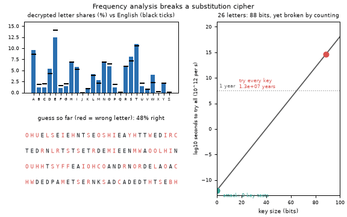
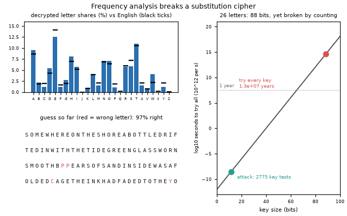

# What you are building toward

An animated attack on a substitution cipher whose key space is 26! (about 4 x 10^26 keys, 88 bits). The ciphertext letter counts are matched to English, then improved step by step; the histogram slides into line with English and the text turns readable. A chart beside it shows key size against the time to try every key, with the attack's own effort marked: a few thousand key tests instead of 4 x 10^26. Your goal over the coming sessions: build that attack yourself, and then learn how modern designs avoid exactly this kind of weakness.

*Target: frequency analysis recovers a substitution key; the chart shows 26! keys against the attack's effort*

*Target, final frame: the histogram lines up with English and the text is readable*

These results come from a private reference build. The code is not published; the roadmap shows the path so you can build your own.

Live links:

- [Math Visual Studio (Studio root): explore the mathematics behind the lessons](https://krunalpanchal1995.github.io/studio/)
