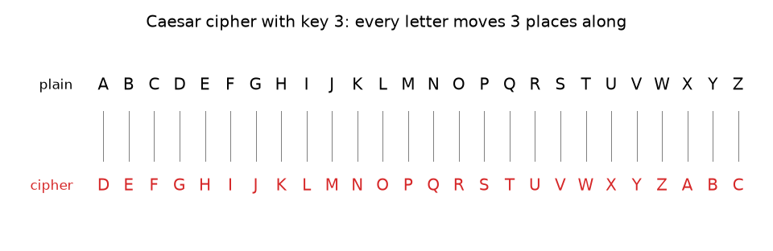
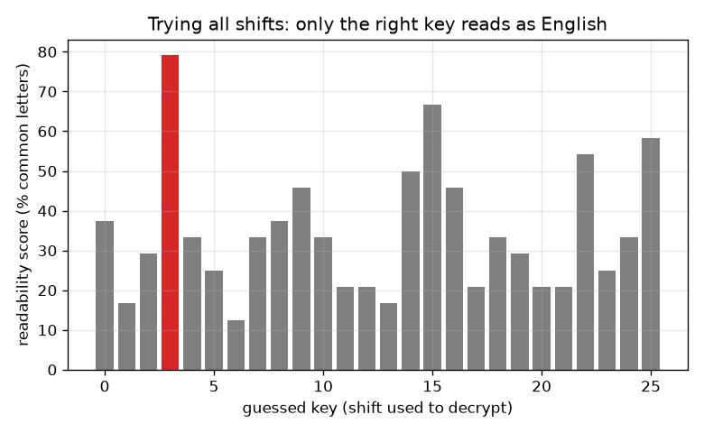

# Session 1: A secret message: the Caesar shift cipher

*Level 1 (conceptual interactive model) · about 60 minutes · opencrypto*

> This is a simplified educational model. It is not a validated design tool and must not be used for real structures, electrical installations, vehicles, industrial processes or medical decisions.

**Prerequisites**

- Remainders: the clock arithmetic of 'mod' (explained in Section B).
- You have read PRIMER.md and run `python start.py 1` once.

**Learning objectives.** After this session you can:

- Encrypt and decrypt a message by hand with a Caesar shift.
- Explain why a Caesar cipher has only 25 useful keys and why anyone can try them all.
- Use a readability score to pick the right shift automatically.
- Say why a cipher that is easy to break is still useful for learning but never for real secrets.

## A. Real-world problem
You want to pass a note in class so that only your friend can read it. A trick used by Julius Caesar is to replace every letter by the letter a fixed number of places further along the alphabet. The note looks like nonsense to anyone who does not know the number. How do you do it, how does your friend undo it, and how long would it take a curious classmate to read it anyway? This is a toy: it shows the vocabulary of cryptography (plaintext, ciphertext, key) in the simplest setting. Real secrets must never be protected with it.

## B. Concept and theory
Number the letters A = 0, B = 1, ..., Z = 25. The plaintext is the readable message and the ciphertext is the scrambled one. The key k is the number of places to shift. To encrypt, add k to each letter number and wrap round after Z by taking the remainder after dividing by 26 (written mod 26). To decrypt, subtract k the same way. Shifts 0 and 26 change nothing, so there are 25 useful keys. An attacker who knows the method simply tries all 25 and reads the one that makes sense. A computer can do this by scoring each candidate: the nine letters E T A O I N S H R make up most of normal English text, but only 9 out of 26 letters (about 35 percent) in a random jumble. The readability score is the share of letters in a candidate that are among those nine.

| Symbol | Meaning | Unit |
|---|---|---|
| p | plaintext letter number (A = 0 ... Z = 25) | no unit |
| c | ciphertext letter number | no unit |
| k | key: how many places to shift | letters |
| score | readability: share of letters among E T A O I N S H R | fraction (or %) |

**Assumptions**

- Only the 26 letters A to Z are shifted; spaces and punctuation are left alone.
- The attacker knows the method (Caesar) and the language (English); only the key is secret.
- Toy model for learning; not a way to protect real information.

$$ c=(p+k)\bmod 26 $$

$$ p=(c-k)\bmod 26 $$

$$ \text{number of useful keys}=26-1=25 $$

$$ \text{score}=\frac{\text{letters in }\{E,T,A,O,I,N,S,H,R\}}{\text{all letters}} $$

## C. Visual explanation
The first figure shows the two alphabet rows for key 3: each plain letter sits above the letter it becomes. The second figure plots the readability score of all 26 guesses for a message encrypted with key 3. The right guess (3) reaches about 79 percent while the best wrong guess reaches about 67 percent: short messages give only a modest gap, but the right shift still stands out and the human eye needs a second to see it.

*Caesar cipher with key 3: each plain letter (top) becomes the letter 3 places along (bottom).*

*Readability score for all 26 guesses: the true key 3 stands out.*

## D. Interactive simulation
Run the lesson (`python start.py 1`), then open the live app: [Session 1: shift, then break](https://krunalpanchal1995.github.io/opencrypto/session-01/) (or `app.html` in this folder). Move the key slider and watch the cipher row slide along the plain row. Then move the guess slider and watch the decrypted text turn into English only when the guess equals the key. Switch to the graph to see all 26 guesses at once.

**Challenge.** Pick a key of 10 or more and decrypt the message by setting the guess equal to the key.

## E. Worked example and experiment
**Problem.** Encrypt SEE YOU AT NOON with key 5, then decrypt it again.

1. S = 18, 18 + 5 = 23 = X. E = 4, 4 + 5 = 9 = J. So SEE becomes XJJ.
2. Y = 24, 24 + 5 = 29, which wraps to 29 - 26 = 3 = D. O = 14, 14 + 5 = 19 = T. U = 20, 20 + 5 = 25 = Z. So YOU becomes DTZ.
3. A = 0 becomes F = 5, and T = 19 becomes Y = 24, so AT becomes FY.
4. N = 13 becomes S = 18 and O = 14 becomes T = 19, so NOON becomes STTS.
5. Ciphertext: XJJ DTZ FY STTS. To decrypt subtract 5: X = 23, 23 - 5 = 18 = S, and so on back to SEE YOU AT NOON.

**Answer.** The ciphertext is XJJ DTZ FY STTS, and decrypting with key 5 returns SEE YOU AT NOON.

**Experiment.** Cut two paper strips with the alphabet written on them, slide one by 5 places and encrypt a short word of your own by looking along the strips; then ask a friend to break it with no key and count how many shifts they try before the word reads sensibly (at most 25). Model versus reality: the maths is exact, but a human may mis-read a letter; the computer's readability score is a statistical guess that can be fooled by very short messages.

## F. Assessment and design challenge
**Question type A: Conceptual.** Why can anyone break a Caesar cipher, even without knowing the key? Does it help to keep the method secret?

Hint

Count the keys, and ask what the attacker does with each one.

Step-by-step solution

There are only 25 useful keys, so an attacker simply decrypts with every one and reads the one that makes sense; this takes a minute by hand and a tiny fraction of a second on a computer. Keeping the method secret does not help much: the method is easy to guess, and a good cipher should stay safe even if the method is public (Session 2). All the strength must be in a key that is too numerous to try.

**Question type B: Numerical.** Encrypt the word GO with key 20. Show the wrap-around, then check by decrypting.

Hint

G = 6 and O = 14. Add 20 and subtract 26 when you pass 25.

Step-by-step solution

G: 6 + 20 = 26, which wraps to 0 = A. O: 14 + 20 = 34, and 34 - 26 = 8 = I. So GO becomes AI. Check: A = 0, 0 - 20 = -20, and -20 + 26 = 6 = G; I = 8, 8 - 20 = -12, and -12 + 26 = 14 = O. Units: letter positions, no physical unit.

**Question type C: Graph and simulation interpretation.** In the graph of readability against guess, why is one bar tall and the others low? Why can the gap be small for a very short message?

Hint

Think about what a wrong shift does to the letter shares.

Step-by-step solution

A wrong shift scrambles the message so its letters look like a random mix, scoring around the random level of about 35 percent on average; the right shift restores the real English shares, so its bar is higher (about 79 percent here against at most about 67 percent for any wrong guess). A short message has few letters, so the shares fluctuate by chance and a wrong guess can occasionally score well; longer messages give a cleaner gap.

**Question type D: Design and optimisation challenge.** Design: you must send a note that a classmate cannot read in the time they have, using only the ideas of this session. List two changes you could make and what each costs.

Hint

Count the possible keys, and think about what you and your friend must share beforehand.

Step-by-step solution

Change 1: use a different shift for different letters (for example a short repeated list of shifts). This raises the number of keys but you and your friend must now share the whole list, and Session 2 shows that short repeating lists can still be broken. Change 2: scramble the alphabet in any order, which gives far more keys, but the shape of the letter counts survives and Session 2 shows how counting breaks it. Trade-off: more keys cost more to share and remember; only a truly random key as long as the message (Session 3) gives perfect secrecy. In real life, use a vetted library, never a home-made cipher.

Score yourself with [RUBRIC.md](../../RUBRIC.md). Print the [activity sheet](activity_sheet.md) to work on paper.

## Common misconceptions
| Common misconception | What is actually true |
|---|---|
| A secret method makes a cipher safe. | A good cipher stays safe even when the method is public; only the key is secret. Caesar fails because the key space is tiny. |
| Shifting by 26 is a strong key. | Shifting by 26 (or 0) changes nothing; that is why there are 25 useful keys, not 26. |
| A bigger shift is a stronger key. | Key 20 is no harder to find than key 2: the attacker tries all 25 in any case. |
| A cipher that I cannot read myself is a secure cipher. | Unreadable to you is not unreadable to a computer. Security is judged against an attacker who tries everything. |

## Glossary
- **plaintext**: the readable message before encryption
- **ciphertext**: the scrambled message after encryption
- **key**: the secret number (or word) that controls how the message is scrambled
- **mod**: the remainder after division; 'mod 26' wraps round the alphabet
- **brute force**: trying every possible key
- **cipher**: a method for scrambling a message with a key

## Finish
1. Do the three coding tasks in [exercises.md](exercises.md).
2. Run `python start.py 1` again after your changes. It ends with the checkpoint; when it prints `PASS`, you are done. (Checkpoint only: `python start.py check 1`.)

Next: [Session 2](../session-02/README.md)
