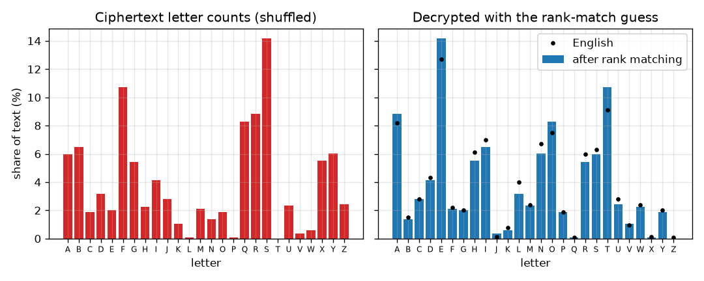
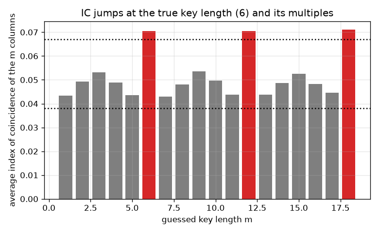
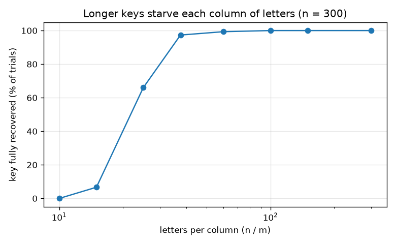

# Session 2: The key space, frequency analysis and Vigenere

*Level 2 (mathematical engineering model) · about 75 minutes · opencrypto*

> This is a simplified educational model. It is not a validated design tool and must not be used for real structures, electrical installations, vehicles, industrial processes or medical decisions.

**Prerequisites**

- Session 1: the Caesar cipher.
- Percentages and the idea of a probability (a chance between 0 and 1).

**Learning objectives.** After this session you can:

- Count the keys of a cipher (25 for Caesar, 26! for a substitution cipher) and express them in bits.
- State Kerckhoffs's principle and explain why the attacker is assumed to know the method.
- Write a letter-frequency counter and use it to break a substitution cipher partly.
- Use the index of coincidence to guess the key length of a Vigenere cipher, and design a key length for a given message length.

## A. Real-world problem
Caesar has only 25 keys. A generous fix is to let the key be any rearrangement of the 26 letters: there are about 4 x 10^26 of them, far too many to try one by one. Is the cipher therefore safe? This session shows that counting keys is not enough: language has habits, and the habits leak through the cipher. You will break such a cipher by counting letters, then try to repair it with the Vigenere cipher, and finally ask how long a key must be. Everything uses toy ciphers and standard textbook results; it is not a recipe against real systems.

## B. Concept and theory
Key space: the number of different keys. A substitution cipher replaces each letter by another letter through a fixed rearrangement (permutation) of the alphabet, so there are 26 x 25 x ... x 1 = 26! keys. In bits, a key space of size N needs log2 N bits. Kerckhoffs's principle: a cipher should stay secure even if everything about it except the key is public, so we assume the attacker knows the method. Frequency analysis: in English, E is the most common letter (about 12.7 percent), then T, A, O, I, N. A substitution only relabels letters, so the sorted letter counts of the ciphertext are the sorted letter counts of the plaintext: matching ranks gives good guesses for the common letters. The Vigenere cipher shifts letter i by letter (i mod m) of a key word of length m, so the letter E no longer always becomes the same letter. But every m-th letter forms a column that is a Caesar cipher. The index of coincidence IC is the chance that two letters drawn without replacement from a text are equal. English gives about 0.067 (the sum of squared letter probabilities of the table is 0.0655), random letters give 1/26 = 0.038. Cutting the ciphertext into m columns gives IC near 0.07 per column only when m is the key length (or a multiple of it). For a whole Vigenere ciphertext with a random key of length m, the expected IC is 1/26 + (0.0655 - 1/26)/m. Each column must contain enough letters for its counts to show English: about 10 letters give the right shift roughly 7 times in 10, and 25 letters give it more than 95 times in 100.

| Symbol | Meaning | Unit |
|---|---|---|
| N | number of keys (key space) | no unit |
| bits | log2 N | bits |
| m | length of the Vigenere key word | letters |
| n | number of letters in the message | letters |
| n_i | how many times letter i occurs in a text | count |
| IC | index of coincidence | no unit (0 to 1) |
| n/m | letters per column | letters |

**Assumptions**

- The attacker knows the method and the language; the key is chosen at random.
- The plaintext is plain English; English letter shares come from a standard textbook table.
- Our test texts are generated from the table's letter shares; real text has more structure (pairs of letters, words) that attackers can also use.
- Educational toy models; real systems use vetted algorithms, not these ciphers.

$$ N_{\text{substitution}}=26!=26\cdot25\cdots1\approx4.03\times10^{26},\qquad \text{bits}=\log_2 N\approx88.4 $$

$$ N_{\text{Vigenere}}=26^{m} $$

$$ \mathrm{IC}=\frac{\sum_{i}n_i(n_i-1)}{n(n-1)} $$

$$ \mathrm{IC}_{\text{whole text}}\approx\frac{1}{26}+\frac{0.0655-1/26}{m} $$

## C. Visual explanation
The first figure shows the ciphertext letter counts of a substitution cipher on the left and, on the right, the counts after matching ranks with English (black dots mark the English table): the common letters line up. The second figure shows the average IC of the columns for each guessed key length of a Vigenere ciphertext with a 6-letter key: it jumps to about 0.07 at 6, 12 and 18 and stays between 0.04 and 0.055 elsewhere. The third shows the success rate of the column attack against letters per column for a message of 300 letters: at least 90 percent for a key of length 8, falling to under 15 percent at key length 20.

*Letter counts of a substitution ciphertext, and after matching ranks with English (black dots).*

*Average IC for each guessed key length of a Vigenere ciphertext with key length 6.*

*Share of runs in which the whole key is recovered, against letters per column (300 letters).*

## D. Interactive simulation
Run the lesson (`python start.py 2`), then open the live app: [Session 2: key length, letters per column, and key space](https://krunalpanchal1995.github.io/opencrypto/session-02/) (or `app.html` in this folder). Change the key length m and message length n. Watch the columns picture (letters per column), the IC curve, and the key space chart in which the Vigenere line eventually crosses the 26! line.

**Challenge.** Make the Vigenere key space larger than 26! while leaving fewer than 10 letters in each column.

## E. Worked example and experiment
**Problem.** (a) How many keys does a substitution cipher have, and how many bits is that? (b) Compute the index of coincidence of the word LETTER by hand.

1. (a) 26! = 403291461126605635584000000, about 4.03 x 10^26.
2. bits = log2(26!) = about 88.4, so a brute-force search must name one of 2^88.4 keys.
3. (b) Letter counts in LETTER: L 1, E 2, T 2, R 1. Compute n_i (n_i - 1): L 0, E 2, T 2, R 0, sum 4.
4. n = 6, so n(n - 1) = 30 and IC = 4/30 = 2/15 = 0.1333.
5. A six-letter word is far too short to estimate IC; the answer is exact for that word but says little about English.

**Answer.** 26! is about 4.03 x 10^26 keys (88.4 bits), and the IC of LETTER is 2/15 = 0.1333.

**Experiment.** Take a newspaper paragraph of about 500 letters, count the E's and compare with the 12.7 percent of the table. Then encrypt a few lines with a scrambled alphabet written on a strip of paper and let a friend count the symbols. Model versus reality: short or unusual texts (a text with no E at all, or one full of names) have different letter shares, so frequency analysis needs enough text; the table is an average over many books.

## F. Assessment and design challenge
**Question type A: Conceptual.** A substitution cipher has about 4 x 10^26 keys. Why is it still easy to break? What does Kerckhoffs's principle say about the attacker?

Hint

Does the attacker need to try the keys one by one?

Step-by-step solution

The attacker does not search the key space; the cipher leaks the letter counts, because the same plaintext letter always gives the same ciphertext letter. Matching the sorted counts with English gives the common letters at once and the rest follows from words. Having many keys is necessary but not sufficient. Kerckhoffs's principle: assume the attacker knows the method completely; only the key is secret, so the method must be strong enough to survive that.

**Question type B: Numerical.** Encrypt HELLO with the Vigenere key AB. Then say how many keys of length 3 exist.

Hint

A = 0 and B = 1, so the shifts alternate 0, 1, 0, 1, 0.

Step-by-step solution

H + 0 = H, E + 1 = F, L + 0 = L, L + 1 = M, O + 0 = O, so the ciphertext is HFLMO. Keys of length 3: 26^3 = 17576 (each of 3 letters is free); the count is a pure number, and 26^6 = 308915776 for length 6.

**Question type C: Graph and simulation interpretation.** In the figure of IC against guessed key length, why are there tall bars at 6, 12 and 18 but not at 4 or 5?

Hint

What happens to the columns when the guessed length is a multiple of the true length?

Step-by-step solution

If the guessed length is 6 (or 12, 18) every column contains letters that were all shifted by the same key letter, so each column is a Caesar cipher of English and has IC near 0.07. With a wrong length such as 4 or 5, every column mixes letters shifted by different key letters, so the counts flatten and IC falls to between 0.04 and 0.055. The smallest tall bar is the key length.

**Question type D: Design and optimisation challenge.** Design: a message has 300 letters and you use a Vigenere cipher. Using the simulation facts of this session, choose a key length that stops the simple column attack, and give the trade-off. Why not just use a key as long as the message?

Hint

Compare the success rates at key lengths 8 and 20 for 300 letters, and remember what each party must remember or share.

Step-by-step solution

For 300 letters the column attack recovers the key in at least 90 percent of runs at key length 8 (about 37 letters per column) but in under 15 percent at key length 20 (15 letters per column). So choose a key of about 20 letters or more. Trade-offs: a long key must be shared securely and remembered or stored, and Vigenere remains a toy because other attacks and the repeating key structure still exist. A key as long as the message, random and used once, is the one-time pad (Session 3), which gives perfect secrecy but needs a fresh key for every message, which is why real systems use vetted algorithms and libraries instead.

Score yourself with [RUBRIC.md](../../RUBRIC.md). Print the [activity sheet](activity_sheet.md) to work on paper.

## Common misconceptions
| Common misconception | What is actually true |
|---|---|
| A cipher with a huge number of keys is safe. | 26! is huge, yet counting letters breaks a substitution cipher. The key space must be large and the cipher must not leak statistics. |
| Vigenere cannot be attacked by frequency analysis. | It resists plain counting of the whole text, but each column is a Caesar cipher; IC finds the key length and then each column is counted. |
| IC of 0.067 means a text is certainly English. | IC is a statistical hint: short texts fluctuate a lot, and other texts can have similar values. |
| A longer key is always stronger. | A longer key helps only if the cipher has no structure to attack and the key is random; a key made of a favourite word has far fewer likely values than the key space suggests. |

## Glossary
- **key space**: the number of different possible keys
- **permutation**: a rearrangement of a list; 26 letters can be arranged in 26! ways
- **factorial**: n! = n x (n-1) x ... x 1
- **bit**: a binary digit; a key space of N keys needs log2 N bits
- **Kerckhoffs's principle**: a cipher should stay secure when everything except the key is public
- **frequency analysis**: using letter counts to break a cipher
- **index of coincidence**: the chance that two letters drawn from a text are the same
- **column**: every m-th letter of a Vigenere ciphertext; a Caesar cipher in disguise

## Finish
1. Do the three coding tasks in [exercises.md](exercises.md).
2. Run `python start.py 2` again after your changes. It ends with the checkpoint; when it prints `PASS`, you are done. (Checkpoint only: `python start.py check 2`.)

Next: [Session 3](../session-03/README.md)
