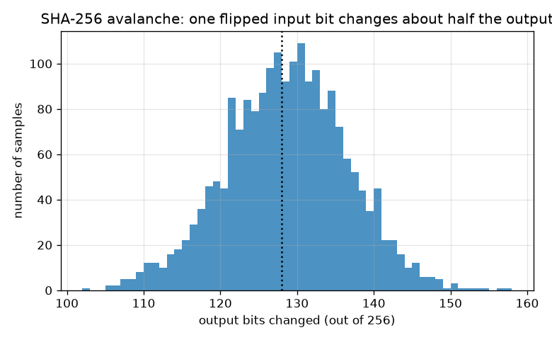
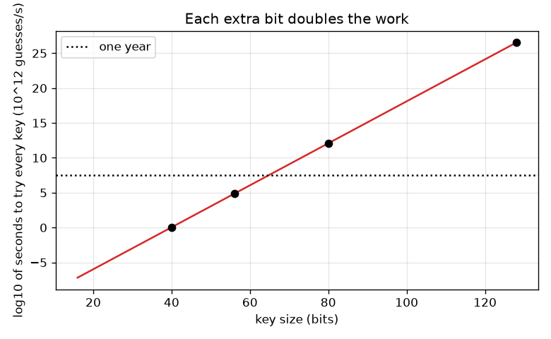

# Session 3: Perfect secrecy, hashes, HMAC and key size

*Level 3 (simulation and validation) · about 90 minutes · opencrypto*

> This is a simplified educational model. It is not a validated design tool and must not be used for real structures, electrical installations, vehicles, industrial processes or medical decisions.

**Prerequisites**

- Session 1 and Session 2.
- Powers of two (2^10 = 1024) and bytes as numbers from 0 to 255.

**Learning objectives.** After this session you can:

- Explain the one-time pad, why it gives perfect secrecy, and why reusing the key breaks it.
- Show that a short key (16 bits) is found by trying everything, and compute the time to try 2^b keys at a stated rate.
- Verify the avalanche effect of SHA-256, and explain why salted PBKDF2 hashes defeat a precomputed table.
- Use HMAC with a constant-time comparison to detect a changed message.

## A. Real-world problem
Is there any cipher that cannot be broken, however much computing power an attacker has? Is a hash the same thing as encryption? How do websites check a password without storing it, and how does a receiver know that a message was not changed on the way? This session answers with toy versions of the real ideas and with numbers. Defensive education only: toy data, standard textbook results, and the clear rule that real systems must use vetted libraries, never home-made cryptography.

## B. Concept and theory
XOR (written ^) combines two bits and is its own inverse: x ^ k ^ k = x. One-time pad: encrypt by XOR with a truly random key as long as the message and used only once. Then for the same ciphertext every plaintext of that length is possible (some key would give it), so the ciphertext reveals nothing: perfect secrecy. If a key is used for two messages, c1 ^ c2 = p1 ^ p2 and the key cancels, so the XOR of two texts is exposed; a known piece of one text then reveals the same piece of the other. A stream cipher stretches a short seed into a long pseudo-random keystream; if the seed has only b bits, an attacker tries at most 2^b seeds. Our toy generator is deliberately weak. A hash such as SHA-256 maps any input to 256 bits; the avalanche effect means one flipped input bit changes each output bit with chance one half, so on average 128 of 256 bits change, with a spread (standard deviation) of sqrt(256 x 0.5 x 0.5) = 8. Password storage: store a salted hash, hash = PBKDF2(password, salt, repetitions). The salt is random and different for every user, so equal passwords give different hashes and one precomputed table (hash to password) no longer works for all users; the attacker must hash the whole dictionary for each user. HMAC(key, message) is a hash that needs the secret key, so only key holders can make a valid tag; compare tags with a constant-time comparison so timing does not leak where they differ. Key size: trying all 2^b keys at r guesses per second takes 2^b / r seconds (half of that on average).

| Symbol | Meaning | Unit |
|---|---|---|
| p, c, k | plaintext, ciphertext and key bytes | bytes |
| b | key size | bits |
| r | guesses per second (assumed) | guesses per second |
| t | time to try all keys | seconds |
| h | hash output | 256 bits for SHA-256 |
| salt | random value stored with the hash | 16 random bytes here |

**Assumptions**

- The pad key is truly random, as long as the message and never reused; the toy stream cipher is not secure.
- Guess rates are assumptions chosen to compare key sizes; they are not measurements of any real machine.
- Password dictionaries and users are made up; PBKDF2 uses few repetitions so the lesson runs fast.
- Toy models for learning; real systems must use vetted libraries and current guidance, never home-made cryptography.

$$ x\oplus k\oplus k=x,\qquad c_1\oplus c_2=(p_1\oplus k)\oplus(p_2\oplus k)=p_1\oplus p_2 $$

$$ t=\frac{2^{b}}{r}\quad\text{(average }t/2\text{)} $$

$$ \text{flipped bits}\sim\text{Binomial}(256,\tfrac12):\quad \text{mean }128,\ \text{std }\sqrt{256\cdot\tfrac14}=8 $$

$$ \text{tag}=\mathrm{HMAC}_{K}(m) $$

## C. Visual explanation
The first figure shows the avalanche effect: over 2000 random messages, flipping one input bit changes about 128 of the 256 SHA-256 output bits (mean 128.2 in the lesson run, spread about 8). The second figure plots log10 of the time to try every key against key size at 10^12 guesses per second: a straight line, since each extra bit doubles the time, which crosses the one-year line between 56 and 80 bits.

*Bits changed in SHA-256 when one input bit is flipped, over 2000 random messages: centred at 128 of 256.*

*Time to try every key against key size at 10^12 guesses per second (log scale): each bit doubles the time.*

## D. Interactive simulation
Run the lesson (`python start.py 3`), then open the live app: [Session 3: key size against brute-force time](https://krunalpanchal1995.github.io/opencrypto/session-03/) (or `app.html` in this folder). Change the key size and the guess rate. Watch the line in the time graph and the bars: 40 bits falls in seconds, 128 bits is out of reach for any rate on the slider.

**Challenge.** Choose a key size so that trying every key takes more than 100 years at 10^12 guesses per second.

## E. Worked example and experiment
**Problem.** How long does it take to try all keys of 40 bits (a) at 10^6 guesses per second and (b) at 10^12 guesses per second? How many bits are needed so that trying all keys takes at least 100 years at 10^12 per second?

1. 2^40 = 1099511627776 keys.
2. (a) 1099511627776 / 10^6 = 1099512 seconds. Divide by 86400 seconds per day: about 12.7 days.
3. (b) 1099511627776 / 10^12 = about 1.1 seconds.
4. 100 years = 100 x 365.25 x 86400 = 3.156 x 10^9 seconds. Keys needed at 10^12 per second: 3.156 x 10^21.
5. log2(3.156 x 10^21) = 71.4, so round up to 72 bits. Check: 71 bits is just under 100 years, 72 bits is just over.

**Answer.** 2^40 keys take about 12.7 days at 10^6 per second and about 1.1 seconds at 10^12 per second; 72 bits are needed for at least 100 years at 10^12 per second.

**Experiment.** Time your own computer: run the 16-bit brute force of the lesson and divide 65536 by the seconds taken to get your real guesses per second; then compute how long 2^40 would take at that rate. Model versus reality: real attackers use many machines or special hardware, and real keys are not always chosen uniformly (people pick predictable passwords), so the rate is an assumption and the table is only a comparison between key sizes.

## Real-world application and mini-project: Decrypt a Vigenere ciphertext you did not write the key for
The lesson of Session 3 generates a Vigenere ciphertext (999 letters) from a hidden key. You may use only the ciphertext and the public facts about English. First find the key length with the index of coincidence, then find each key letter with letter frequencies, and finally read the message. This is a toy exercise on data made for it; it teaches why short repeating keys are weak.

**Deliverable:** A script that prints the average index of coincidence for guessed key lengths 1 to 12, names the key length, prints the recovered key and the first line of the decrypted message, and saves a bar chart of IC against key length.

**Success looks like:** The key length found is 6, the key recovered is BEACON, and the decrypted text equals the original message exactly.

## F. Assessment and design challenge
**Question type A: Conceptual.** Why does reusing a one-time pad key destroy its security, even though the pad is perfectly secret when used once?

Hint

XOR the two ciphertexts and see what happens to the key.

Step-by-step solution

c1 ^ c2 = (p1 ^ k) ^ (p2 ^ k) = p1 ^ p2, because k ^ k = 0. The key disappears and the attacker holds the XOR of two plaintexts, which still has the structure of language; if any part of p1 is known or guessed, the same part of p2 is revealed at once. The perfect-secrecy proof needs a fresh key for each message.

**Question type B: Numerical.** A 40-bit key is tried at 10^6 guesses per second. How long does a full search take, and how does that change if the key has 41 bits?

Hint

t = 2^b / r.

Step-by-step solution

t = 2^40 / 10^6 = about 1.1 x 10^6 seconds = about 12.7 days. One extra bit doubles the number of keys, so 41 bits take about 25.5 days. Sanity check: 10^6 seconds is about 11.6 days, so 1.1 x 10^6 seconds is a little more, close to 12.7 days.

**Question type C: Graph and simulation interpretation.** In the time graph, which of the key sizes 40, 56, 80 and 128 bits are within one year at 10^12 guesses per second? What does the shape of the line tell you?

Hint

Compare each dot with the dotted one-year line.

Step-by-step solution

40 bits (about 1.1 seconds) and 56 bits (about 20 hours) lie below the one-year line; 80 bits (about 38300 years) and 128 bits (about 1.08 x 10^19 years) lie far above it. The line is straight because log10 t = b log10 2 - log10 r grows by the same step for every extra bit: each bit doubles the work.

**Question type D: Design and optimisation challenge.** Design: a site stores 5 users' passwords. Compare (i) plain SHA-256 hashes with (ii) salted PBKDF2 hashes against an attacker who has a table for a dictionary of 8 words. State what the attacker must do in each case and give the work.

Hint

How many hashes must be computed in each case, and can the table be reused?

Step-by-step solution

(i) Plain hashes: the attacker builds one table of 8 hashes once and finds all 5 users by lookup. In the lesson the table cracks 5 of 5 users, and equal passwords visibly have equal hashes. (ii) Salted PBKDF2: each user has a random salt, so the table finds 0 of 5 users; the attacker must compute 5 x 8 = 40 slow hashes (or more for a bigger dictionary), and equal passwords have different hashes. Trade-off: the site pays for the slow hash on every login and must store a salt per user. Salts do not protect weak passwords from a determined search; they only force the attacker to work per user. Use a vetted library and current guidance, never home-made schemes.

Score yourself with [RUBRIC.md](../../RUBRIC.md). Print the [activity sheet](activity_sheet.md) to work on paper.

## Common misconceptions
| Common misconception | What is actually true |
|---|---|
| A hash is encryption: you can decrypt it with the key. | A hash has no key and cannot be undone; it only lets you check a guess by hashing it again. Encryption is reversible with the key. |
| The one-time pad is unbreakable even if the key is reused. | Perfect secrecy needs a truly random key, as long as the message, used once. Reuse leaks the XOR of the messages. |
| Salts are secret. | A salt is stored beside the hash and need not be secret; its job is to make every user's hash different and defeat precomputed tables. |
| Comparing tags with == is fine. | A comparison that stops at the first difference can leak timing information; use a constant-time comparison such as hmac.compare_digest. |
| Home-made ciphers are fine if they look complicated. | Complexity is not security. Real systems must use vetted libraries and protocols reviewed in public for years. |

## Glossary
- **XOR**: bitwise exclusive or; 1 when the two bits differ; applying it twice undoes it
- **one-time pad**: XOR with a random key as long as the message, used once
- **perfect secrecy**: the ciphertext gives the attacker no information about the plaintext
- **stream cipher**: a cipher that XORs the message with a keystream made from a short key
- **hash function**: a one-way function mapping any input to a fixed-size output
- **avalanche effect**: a one-bit change of the input changes about half of the output bits
- **salt**: a random value stored with a password hash, different for every user
- **PBKDF2**: a password hashing method that repeats HMAC many times to be slow on purpose
- **HMAC**: a keyed hash used to detect changes to a message
- **constant-time comparison**: a comparison whose running time does not depend on where the first difference is

## Finish
1. Do the three coding tasks in [exercises.md](exercises.md).
2. Run `python start.py 3` again after your changes. It ends with the checkpoint; when it prints `PASS`, you are done. (Checkpoint only: `python start.py check 3`.)

Next: the [roadmap](../../promo/roadmap.md). Session 4 is yours to build.
